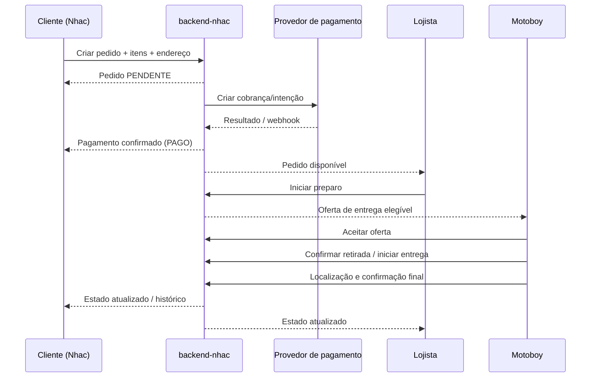
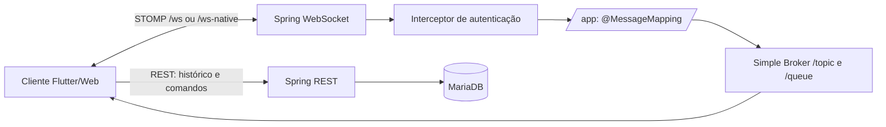
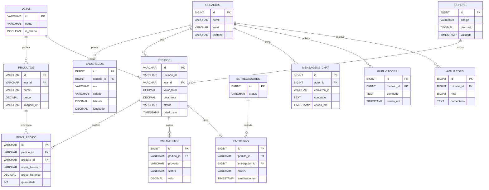

# Nhac Delivery — Documentação Técnica e Funcional do Ecossistema

> **Estado do documento:** levantamento técnico baseado nos arquivos das branches `main` consultados em 29/10/2026.  
> **Escopo:** `Nhac`, `backend-nhac`, `Nhac-Lojas`, `Nhac-Motoboy`, `Nhac-WEB` e `Nhac-lojista-web`.  
> **Regra de leitura:** “Implementado” indica evidência encontrada no código/manifests consultados; “Contrato/fluxo” resume o comportamento conhecido; “A confirmar” identifica detalhe que precisa ser conferido em todos os arquivos/ambientes antes de ser tratado como garantia.

Esta documentação distingue a arquitetura real de recomendações. Não presume que funcionalidades citadas no escopo (por exemplo, uma política universal de cache L1/L2, fallback de chat ou animação específica) estejam implementadas em todos os clientes sem evidência.

## Sumário

1. [Visão geral do produto](#1-visão-geral-do-produto-produto--negócio)
2. [Arquitetura e tecnologias](#2-arquitetura-de-software--tecnologias-full-stack)
3. [Rotas, navegação e transições](#3-rotas-navegação--transições-visuais)
4. [Dados, rede e tempo real](#4-camada-de-dados-rede--tempo-real)
5. [Cache e modo offline](#5-estratégias-de-cache--modo-offline)
6. [Design system e componentes](#6-design-system-ui--componentes-reutilizáveis)
7. [Modelagem de dados (MER/DER)](#7-modelagem-de-dados-mer-e-der)
8. [Ambiente, configuração e contribuição](#8-guia-de-ambiente-configuração--contribuição)
9. [Referências dos repositórios](#9-referências-de-código)

---

# 1. VISÃO GERAL DO PRODUTO (PRODUTO & NEGÓCIO)

## 1.1 Propósito

Nhac é um ecossistema de marketplace/delivery que conecta consumidores a estabelecimentos, coordena pagamento e preparação e oferece ferramentas para operação da loja e entrega de última milha (*last-mile*). O modelo O2O (Online-to-Offline) transforma uma intenção digital — descobrir um estabelecimento e comprar — em uma operação física de preparo, retirada e entrega.

A plataforma é multiaplicação e multiator. Os clientes compartilham uma API central, mas cada cliente tem suas próprias telas, estados locais, configuração e ciclo de release. A API e o banco são a fonte de verdade para pedidos, permissões, pagamentos e transições críticas.

## 1.2 Atores e responsabilidades

| Ator | Interface principal | Responsabilidades |
|---|---|---|
| Cliente | `Nhac` Flutter; `Nhac-WEB` React | Cadastro/login, descoberta, carrinho, checkout, pagamento, rastreio, chat, avaliações/feed e perfil. |
| Lojista/equipe | `Nhac-Lojas` Flutter; `Nhac-lojista-web` React | Receber pedidos, atualizar preparo, manter catálogo, conversar com clientes e administrar loja/equipe conforme o papel. |
| Entregador | `Nhac-Motoboy` Flutter | Disponibilidade, ofertas/corridas, aceite, navegação, GPS, confirmação de entrega, histórico e repasses exibidos pelo backend. |
| Administrador/operador | APIs e telas administrativas disponíveis | Operação e suporte conforme endpoints e permissões existentes; não se presume que exista um único painel administrativo universal. |

## 1.3 Fluxo principal de pedido

O fluxo operacional conhecido é:

1. O cliente monta o carrinho e envia o pedido com endereço e dados de entrega.
2. O backend persiste o pedido em estado inicial (no fluxo observado, `PENDENTE`) e registra os itens com seus valores históricos.
3. O pagamento é confirmado pelo fluxo/provedor de pagamento; o pedido passa a `PAGO`.
4. O lojista aceita/inicia o preparo (`PREPARANDO`). Essa etapa pode habilitar o despacho.
5. O serviço de entrega publica/gerencia uma oferta elegível. O entregador aceita e fica associado à corrida.
6. Na retirada, o pedido transita para o estado de entrega (`SAIU_ENTREGA`, conforme contrato existente).
7. O entregador transmite localização quando permitido e conclui a entrega mediante o mecanismo de confirmação configurado.
8. O cliente e o lojista consultam o estado consolidado; o histórico deve refletir os estados terminais.



**Invariantes importantes:** preço e nome históricos dos itens não devem mudar se o catálogo for editado depois da compra; pagamento e despacho precisam ser idempotentes; a aceitação de uma oferta deve ser atômica; o cliente não pode declarar como concluída uma etapa operacional pertencente ao entregador.

## 1.4 Módulos funcionais

| Módulo | Capacidades | Observações |
|---|---|---|
| Onboarding e identidade | Cadastro, e-mail/telefone, senha, recuperação e login social conforme configuração | O app cliente usa Firebase para partes de identidade e possui integração com backend; não confundir autenticação Firebase com autorização JWT da API. |
| Catálogo | Home, lojas, produtos, pesquisa e filtros | API central; cache público no backend configurado com Caffeine. |
| Carrinho e checkout | Itens, quantidades, subtotal, frete, cupom, endereço e criação do pedido | Valores finais devem ser recalculados/validados no servidor. |
| Pagamentos | Stripe e Asaas/Pix conforme configuração do backend | Chaves privadas/webhook ficam no backend; chave publicável Stripe pode estar no cliente. |
| Pedidos | Lista, detalhe, estado e rastreio | Estado do backend é autoridade; telas devem atualizar ao voltar ao foco/reconectar. |
| Chat | Cliente–loja e fluxos associados a pedido/entrega | REST fornece histórico/ações e STOMP/WebSocket entrega eventos; os destinos exatos devem ser verificados no controlador/serviço de cada cliente. |
| Feed/comunidade | Publicações, detalhes, links compartilháveis e itens salvos | Rotas de publicação/produto são deep links públicos no app cliente; permissões e operações são validadas pelo backend. |
| Perfil e endereços | Dados pessoais, preferências, endereços e métodos de pagamento | Coordenadas são relevantes para cálculo/roteamento; pedidos antigos podem não ter latitude/longitude. |
| Operação do lojista | Pedidos, produtos, chat, equipe, financeiro e configurações | O painel web tem papéis `administrador`, `gerente` e `atendente`; a UI deve ser coerente com as permissões do backend. |
| Operação do entregador | Disponibilidade, ofertas, GPS, histórico, suporte e resumo de frete | A localização tem validade temporal; localização antiga não deve ser tratada como posição atual. |

---

# 2. ARQUITETURA DE SOFTWARE & TECNOLOGIAS (FULL STACK)

## 2.1 Mapeamento multi-repositório

| Repositório | Stack verificada | Responsabilidade |
|---|---|---|
| [Nhac](https://github.com/NhacDelivery/Nhac) | Flutter/Dart, Provider, GoRouter, Dio, Firebase, Stripe, Google Maps/Places, STOMP | Aplicativo consumidor; catálogo, carrinho, pedido, pagamento, perfil, feed e chat. |
| [backend-nhac](https://github.com/NhacDelivery/backend-nhac) | Java 25 declarado no Maven, Spring Boot 4.1.1, Spring MVC/Security/Data JPA, MariaDB, Flyway, WebSocket/STOMP, Caffeine, Stripe, Twilio, Google Cloud Storage | API de domínio, autenticação/autorização, regras de negócio, persistência, pagamentos, entrega e eventos em tempo real. |
| [Nhac-Lojas](https://github.com/NhacDelivery/Nhac-Lojas) | Flutter/Dart, Provider, GoRouter, HTTP, STOMP, ScreenUtil, fl_chart | Aplicativo mobile operacional do estabelecimento. |
| [Nhac-Motoboy](https://github.com/NhacDelivery/Nhac-Motoboy) | Flutter/Dart, Provider, GoRouter, HTTP, STOMP, Geolocator, flutter_map/latlong2 | Aplicativo do entregador, localização e execução de corridas. |
| [Nhac-WEB](https://github.com/NhacDelivery/Nhac-WEB) | React 19, TypeScript, Vite 8, Tailwind CSS 4, Firebase, React Router, Framer Motion | Interface web do consumidor. O README ainda é próximo do template Vite; validar quais fluxos já estão ligados à API. |
| [Nhac-lojista-web](https://github.com/NhacDelivery/Nhac-lojista-web) | React, TypeScript, Create React App, STOMP.js/SockJS, Vercel Functions | Painel web do lojista: pedidos, produtos, chat, equipe, financeiro e configurações. Há telas/fixtures locais em algumas áreas; não presumir que todo módulo seja API-first. |

> **Banco real:** o backend configura o driver MariaDB e Flyway com migrações SQL compatíveis com MySQL/MariaDB. Portanto, este documento descreve o banco físico como **MariaDB/MySQL**, não PostgreSQL. H2 aparece como dependência de testes e Testcontainers MariaDB também é usado em testes de integração.

## 2.2 Flutter — app cliente Nhac

O `pubspec.yaml` declara Dart `>=3.2.0 <4.0.0`; a versão exata do Flutter/Dart deve ser fixada pelo SDK usado no CI e/ou por `flutter --version` (não deduzir uma versão exata somente pelo constraint).

| Dependência declarada | Uso |
|---|---|
| `go_router ^17.1.0` | Rotas, parâmetros, deep links e redirecionamento conforme autenticação. |
| `provider ^6.1.5` | Injeção de dependência e estado reativo via `ChangeNotifier`. |
| `dio ^5.9.1` | Cliente HTTP; confirmar interceptors e política de retry no serviço concreto. |
| `shared_preferences ^2.5.4` | Preferências/cache local não secreto. |
| `flutter_secure_storage ^9.2.2` | Armazenamento local de credenciais/identificadores sensíveis. |
| `cached_network_image ^3.4.1` | Cache de imagens remotas. |
| `flutter_screenutil ^5.9.3` | Adaptação de dimensões e fontes. |
| `stomp_dart_client ^3.0.1` | Cliente STOMP/WebSocket para eventos em tempo real. |
| `firebase_core`, `firebase_auth`, `cloud_firestore`, `firebase_messaging`, `firebase_storage`, `firebase_app_check` | Serviços Firebase para identidade, push, dados/armazenamento e proteção do app, conforme uso por módulo. |
| `flutter_stripe ^10.1.1`, `pay ^3.3.0`, `qr_flutter ^4.1.0` | Integração visual de pagamento e QR; a confirmação final deve vir do backend/provedor. |
| `geolocator`, `geocoding`, `google_maps_flutter`, `flutter_google_places_sdk` | Localização, geocodificação, mapa e busca de endereços. |
| `connectivity_plus` | Sinais de conectividade; conectividade do dispositivo não garante disponibilidade da API. |
| `shimmer`, `lottie`, `flutter_svg` | Loading e recursos visuais. |
| `sentry_flutter` | Captura de erros e telemetria. |
| `uuid` | IDs locais/correlação, útil para idempotência e deduplicação quando passado ao contrato. |

### Organização de código

Estrutura observada inclui:

- `lib/main.dart`: inicialização, Firebase, Sentry, Stripe, providers e tema/tamanho base.
- `lib/globals/`: router, constantes e estado/tema compartilhados.
- `lib/controllers/`: estado de tela/domínio (`CartProvider`, `UserProvider`, `EnderecoProvider`, cadastro).
- `lib/repositories/`: acesso a dados de loja, produto e pedido.
- `lib/services/`: autenticação, conectividade, notificações e serviços de domínio.
- `lib/models/`: tipos de pedido, chat, feed e produto.
- `lib/pages/`: páginas/telas de cada fluxo.
- `lib/components/`: componentes reutilizáveis.
- `test/` e `integration_test/`: testes unitários/widget e testes de integração.

Fluxo típico: **Widget/Page → Provider/Controller → Repository/Service → Dio/API → DTO/Model → Provider → rebuild**. Widgets não devem duplicar regras de preço, permissões ou transições críticas que pertencem ao backend.

## 2.3 Backend — Spring Boot

Versões/dependências verificadas no `pom.xml`:

- Spring Boot parent `4.1.1`; Java `25` declarado em `java.version`.
- Spring Web/MVC, Spring Security, Spring Data JPA, Validation, Actuator e cache.
- Flyway + `flyway-mysql`; driver MariaDB.
- Spring WebSocket + Spring Messaging; STOMP com broker simples em memória.
- Caffeine para cache local de consultas públicas de catálogo.
- Stripe Java, Twilio, cliente Google, Google Cloud Storage.
- springdoc OpenAPI para documentação HTTP.
- Testes com Spring Boot Test, H2 e Testcontainers MariaDB.

### Camadas e responsabilidades

| Camada | Responsabilidade |
|---|---|
| Controller / REST | Validar entrada HTTP, autenticação contextual, códigos de resposta e DTOs. |
| Service | Regras de negócio, coordenação de transações e integração com provedores externos. |
| Repository | Consultas e persistência JPA; concorrência deve ser protegida com locks/updates condicionais quando necessário. |
| Entity | Representação persistente; não expor diretamente como contrato público. |
| DTO / Mapper | Contratos de entrada/saída e conversão entre API e domínio. |
| Security | Filtros, identidade, papéis e autorização. |
| Infraestrutura | WebSocket/STOMP, pagamentos, e-mail/SMS, armazenamento, métricas e cache. |
| Flyway | Histórico de schema por migrações versionadas; não editar migrações já aplicadas em ambientes compartilhados. |

### Segurança

O backend inclui Spring Security e biblioteca JWT `java-jwt`. A API deve ser consumida com token conforme o contrato do endpoint e permissões por papel. A presença de OAuth client/Firebase em um cliente não substitui autorização de cada operação na API. Em produção:

- Segredos devem vir de variáveis/secret manager, nunca de valores de fallback de desenvolvimento.
- Webhooks de pagamento devem validar assinatura/token e processar eventos de forma idempotente.
- Validar dono do pedido, escopo da loja e papel do entregador no servidor.
- Limitar CORS e origens WebSocket aos domínios necessários; a configuração WebSocket atualmente usa `setAllowedOriginPatterns("*")`, que deve ser revisada para produção.
- Não registrar tokens, dados de cartão, códigos de confirmação ou payloads pessoais em logs.

---

# 3. ROTAS, NAVEGAÇÃO & TRANSIÇÕES VISUAIS

## 3.1 GoRouter — app cliente

A fonte de verdade é [`lib/globals/router.dart`](https://github.com/NhacDelivery/Nhac/blob/main/lib/globals/router.dart). O router inicia em `/splash`, observa alterações de autenticação por `AuthService` e usa `homeOrderRouteObserver`.

A tabela abaixo lista as rotas declaradas no arquivo consultado; parâmetros marcados como opcionais têm fallback no builder. A autorização final precisa ser conferida no redirect e também nos serviços/API.

| Caminho | Parâmetros/entrada | Página/uso | Guarda/observação |
|---|---|---|---|
| `/splash` | — | Splash/inicialização | Permitida enquanto a sessão é carregada. |
| `/` | — | Rota raiz/redirecionamento | Tratada como pública pelo redirect. |
| `/home-page` | — | Home | Usuário autenticado; usuários anônimos vão para boas-vindas. |
| `/bem-vindo` | — | Onboarding | Pública; usuário autenticado normalmente redireciona para Home. |
| `/bem-vindo-motoca` | — | Entrada alternativa de onboarding | Pública. |
| `/email-cliente` | — | Entrada de e-mail | Pública. |
| `/insira_telefone` | — | Entrada de telefone | Pública. |
| `/verificacao_numero` | `extra: String` número | Verificação de telefone | Pública durante onboarding; número é passado em memória. |
| `/continuar_senha` | — | Continuação por senha | Pública. |
| `/cadastro/senha` | — | Cadastro de senha | Pública. |
| `/cadastro/nome` | — | Nome do cadastro | Pública. |
| `/cadastro/verificar-email` | `extra: String` e-mail | Confirmação de e-mail | Pública; não perder o contexto ao navegar. |
| `/cadastro/telefone` | — | Telefone do cadastro | Pública. |
| `/recuperacao/input` | `extra: String?` método (default `email`) | Início da recuperação | Pública. |
| `/recuperacao/codigo` | `extra: Map` com `metodo`, `contato` | Digitação de código | Pública. |
| `/recuperacao/nova-senha` | `extra: Map` com `metodo`, `contato`, `codigo` | Definição de nova senha | Pública. |
| `/dados-pessoais` | — | Perfil/dados pessoais | Protegida pelo redirect global. |
| `/editar-nome-preferencia` | — | Nome/preferências | Protegida. |
| `/editar-email` | — | Alterar e-mail | Protegida. |
| `/editar-foto` | — | Foto de perfil | Protegida. |
| `/editar-senha` | — | Alterar senha | Protegida. |
| `/enderecos-salvos` | — | Endereços | Protegida. |
| `/formas-pagamento` | — | Formas de pagamento | Protegida. |
| `/cupons` | `extra: num?` subtotal | Cupons | Protegida; subtotal convertido para double. |
| `/carrinho` | — | Carrinho | Protegida. |
| `/checkout` | — | Checkout | Protegida; backend valida dados e valores. |
| `/pagamento` | query `pedidoId` | Pagamento pendente | Protegida; query ausente vira string vazia. |
| `/meus-pedidos` | — | Histórico/lista de pedidos | Protegida. |
| `/search` | query `categoria` | Busca | Protegida; categoria inicial opcional. |
| `/rastreio` | query `pedidoId` | Rastreio | Protegida; transição vertical de 300 ms. |
| `/pedido-detalhes` | query `pedidoId` | Detalhe de pedido entregue | Protegida. |
| `/pedido-entregue` | query `pedidoId` | Confirmação/detalhe de pedido entregue | Protegida. |
| `/mensagens` | — | Lista de conversas | Protegida. |
| `/chat-loja` | `extra: Map` | Conversa com loja | Protegida; confira chaves no restante do builder. |
| `/publicacao/:id` | path `id` | Deep link de publicação | Pública; pode ser armazenada como rota pendente até a sessão/feed estar pronto. |
| `/feed-salvos` | — | Publicações salvas | O builder cria FeedPage; validar redirect global e fluxo de sessão. |
| `/produto/:id` | path `id` | Deep link de produto | Pública; redirecionamento preserva a URL no splash. |

> **Importante:** essa tabela deve ser atualizada sempre que `router.dart` mudar. Rotas de chat/feed adicionais podem aparecer no trecho final do arquivo; confira o arquivo fonte para uma lista automatizada e integral.

### Política de redirect

- Se a sessão ainda não foi carregada, redireciona para `/splash`, preservando a rota de produto em query.
- Se não autenticado e a rota não é pública, redireciona para `/bem-vindo`.
- Se autenticado e acessa uma rota pública de entrada, normalmente redireciona para `/home-page`, exceto rotas explicitamente preservadas (splash, links de produto/publicação e etapas intermediárias de cadastro).
- Deep links de publicação podem aguardar a inicialização do estado do feed.

## 3.2 Transições

- `_SlideRightToLeftPageRoute`: PageRoute customizada de 400 ms, entrada pela direita, saída parcial para esquerda, curvas `easeOutQuart/easeInQuart` e sombra discreta.
- `/rastreio`: `CustomTransitionPage` com slide de baixo para cima, `easeOutCubic`, duração 300 ms.
- O código do router consultado **não comprova** uma classe chamada `_ChatCardExpandPageRoute`, `slideOnExit: false` nem um `flightShuttleBuilder` específico de Avatar/Título/Subtítulo. Se essa animação estiver em outro arquivo/branch, documentar junto ao arquivo que efetivamente a implementa; não tratá-la como parte do router sem evidência.

### Recomendações para animações compartilhadas

1. Use tags Hero únicas e estáveis por elemento/conversa.
2. Para múltiplos elementos, mantenha o mesmo tipo e tag entre origem/destino; forneça `flightShuttleBuilder` apenas quando a composição realmente precisar de widget de voo customizado.
3. Evite transições simultâneas conflitantes no mesmo subtree.
4. Preserve a tela anterior somente se o desenho da rota exigir; verifique acessibilidade, reduzir movimento e custo em dispositivos modestos.

---

# 4. CAMADA DE DADOS, REDE & TEMPO REAL

## 4.1 API REST e Dio

No app cliente, `AppConstants.apiBaseUrl` lê `API_BASE_URL` do `.env` e usa por padrão `https://backend-nhac.cloud.run/api/v1`. O bootstrap carrega o `.env` antes de acessar constantes. O app também declara `flutter_secure_storage` e chaves para token/ID local; a presença dessas chaves não prova, sozinha, a estratégia de refresh token.

Padrão de chamada recomendado:

```dart
final response = await dio.get(
  '$baseUrl/lojas',
  options: Options(
    headers: {'Authorization': 'Bearer $accessToken'},
  ),
);
```

O snippet é ilustrativo, não substitui o contrato real do endpoint. Centralize no cliente HTTP:

- base URL por ambiente;
- cabeçalhos e token;
- timeout de conexão/envio/recebimento;
- serialização e parsing de DTO;
- classificação de erros (rede, timeout, 401/403, validação, conflito, servidor);
- logs sanitizados e correlação;
- política de retry somente para operações seguras ou idempotentes.

**Não repetir automaticamente POST de pedido/pagamento** sem idempotency key e contrato idempotente. Um timeout pode significar que o servidor concluiu a operação e apenas a resposta foi perdida.

## 4.2 WebSocket/STOMP no backend

Implementação verificada em `infra/websocket/WebSocketConfig.java`:

| Item | Valor |
|---|---|
| Handshake SockJS | `/ws` |
| WebSocket nativo | `/ws-native` |
| Prefixo de mensagens destinadas à aplicação | `/app` |
| Broker simples | `/topic` e `/queue` |
| Canal de entrada | `StompAuthChannelInterceptor` |
| Broker | Em memória na instância, não RabbitMQ/ActiveMQ |



O broker simples é local à instância. Em múltiplas instâncias, eventos podem não ser distribuídos a todos os clientes conectados a outros nós; para escalar horizontalmente, planejar broker externo ou mecanismo de distribuição. A configuração de origens `*` deve ser limitada em produção.

### Cliente STOMP

O app cliente e os clientes de operação declaram `stomp_dart_client`; o painel web declara `@stomp/stompjs` e `sockjs-client`. A configuração concreta (URL, tópicos, heartbeat e reconexão) deve ser lida nos serviços específicos, não inferida só pela dependência.

Política recomendada:
- usar token na autenticação do handshake/frame conforme `StompAuthChannelInterceptor`;
- heartbeat de entrada/saída compatível com servidor/proxy;
- reconexão com backoff exponencial e jitter;
- não exibir “enviado” até haver confirmação definida pelo contrato;
- reconsultar REST ao reconectar para reconciliar estado;
- deduplicar eventos por ID persistido e, quando existir no contrato, `clientMessageId`;
- manter REST como mecanismo de recuperação de histórico/estado, não como garantia de fallback automático já existente em todos os clientes.

### Idempotência de mensagens

Um fluxo robusto associa o identificador gerado pelo cliente à mensagem persistida. Se o cliente repetir o envio depois de perder a resposta, o backend deve devolver/identificar a mensagem existente em vez de persistir uma cópia. Esse comportamento deve ser validado para cada implementação de chat; o uso de `uuid` ou a presença de WebSocket não garantem deduplicação por si sós.

## 4.3 Tratamento de falhas

- `401`: tentar recuperar sessão somente se o mecanismo de renovação estiver implementado; caso contrário, pedir novo login.
- `403`: mostrar falta de permissão, sem retry automático.
- `409`: conflito de estado/idempotência; reconciliar com o recurso atual.
- `422`/validação: mostrar mensagem de campo/negócio.
- timeout/rede: preservar dados editados, oferecer retry e consultar estado antes de repetir operação não idempotente.
- WebSocket desconectado: sinalizar conexão degradada, usar REST para reconciliar e evitar estados de sucesso especulativos.

---

# 5. ESTRATÉGIAS DE CACHE & MODO OFFLINE

## 5.1 O que existe hoje

**Backend:** `application.properties` configura Caffeine para cache local por instância de consultas públicas do catálogo, habilitado por padrão, TTL de catálogo `30s`, avaliações `2m`, limites máximos de listas/detalhes configuráveis. Isso não é cache distribuído e não deve ser usado como fonte de verdade para pedidos, pagamentos, disponibilidade ou ofertas.

**Cliente Flutter:** `SharedPreferences` e `flutter_secure_storage` estão declarados. O app cliente define chaves para carrinho, usuário, endereços, GPS e histórico de busca. O uso efetivo de cada chave deve ser confirmado no service/repository correspondente. O app motoboy documenta cache de sessão em memória para alguns dados (por exemplo, frete/histórico 45 s, avaliações 1 min e perfil de exibição 3 min); corridas, ofertas e códigos não são tratados como autoridade em cache.

## 5.2 Modelo em dois níveis (orientação arquitetural)

| Nível | Onde | Bom para | Não usar como autoridade para |
|---|---|---|---|
| L1 | RAM / Provider / cache de repository | Renderização imediata, estado da tela e respostas recentes. | Pagamento, aceite de corrida, estado final de pedido. |
| L2 | SharedPreferences/arquivo local | Preferências e snapshots serializáveis que sobrevivem ao encerramento. | Segredos em texto claro, tokens se já houver armazenamento seguro, estado transacional. |
| Servidor | API + banco | Estado persistente e concorrente | — |

A existência de `SharedPreferences` não comprova que catálogo e histórico de chat tenham uma política universal de L1/L2. A política deve ser documentada por repository: chave, TTL, versionamento, invalidação e comportamento em logout/troca de conta.

## 5.3 Silent refresh e offline

Fluxo recomendado:

1. Renderizar snapshot cacheado imediatamente, com indicação de atualização quando apropriado.
2. Consultar API em segundo plano.
3. Substituir snapshot apenas se a resposta corresponder à conta e à revisão atual.
4. Em erro, manter conteúdo conhecido com data de atualização e ação de retry.
5. Limpar dados de usuário no logout/troca de conta e não compartilhar cache entre identidades.

Carrinho local pode ser persistido para conveniência, mas preço, estoque, cupom, frete e elegibilidade da loja precisam ser validados no checkout. Sem conexão, não declarar pedido/pagamento/entrega como confirmado. Para chat, exibir mensagens locais pendentes como pendentes até confirmação do servidor.

---

# 6. DESIGN SYSTEM, UI & COMPONENTES REUTILIZÁVEIS

## 6.1 Identidade visual

O app Motoboy documenta os seguintes tokens em `DESIGN.md`; a fonte em runtime é `lib/globals/theme_colors.dart`. Eles são uma referência confirmada para o cliente Motoboy, **não uma garantia de que todas as aplicações usam exatamente os mesmos valores**.

| Token | Valor documentado | Uso |
|---|---|---|
| Primária | `#FF6961` | Ação principal/coral |
| Secundária | `#FCDABB` | Destaques suaves |
| Fundo | `#FFE7E5` | Fundo rosado |
| Texto | `#5D201C` | Texto principal |
| Muted | `#757575` | Texto secundário |
| Borda | `#C9BCBC` | Contornos |
| Erro | `#B3261E` | Estado de erro |
| Sucesso | `#2E7D32` | Estado de sucesso |
| Superfície | `#FFFFFF` | Cartões |

Tipografia documentada: Roboto. No app cliente, `main.dart` inicializa `ScreenUtilInit` com design size `390 × 844`, `minTextAdapt: true` e `splitScreenMode: true`.

## 6.2 Responsividade

- Use `.w` para larguras, `.h` para alturas, `.sp` para fonte e `.r` para raios apenas quando a tela inicializa ScreenUtil.
- Evite dimensões escaladas em áreas que devem manter tamanho físico mínimo, como alvos de toque e indicadores de acessibilidade.
- Testar largura de 320 px, texto ampliado, teclado aberto, orientação suportada e SafeArea.
- Na web, usar layout responsivo próprio; `flutter_screenutil` não se aplica ao React.

## 6.3 Componentes e estados

| Componente/padrão | Comportamento esperado |
|---|---|
| Skeleton/shimmer | Mantém estrutura do conteúdo durante carregamento; evitar shimmer infinito após erro. |
| Botão de ação | Estado ocupado bloqueia duplo envio; preserva dimensões e acessibilidade. |
| Input customizado | Label, validação, erro próximo ao campo e preservação do texto após falha. |
| Card de loja/produto | Imagem com proporção definida, placeholder e fallback para erro. |
| Bubble de chat | Distinguir enviado/pendente/confirmado/erro sem depender só da cor. |
| Estado vazio | Explicar ausência de conteúdo e próximo passo possível. |
| `EstadoComRetry` (conceito) | Mostrar erro, contexto e ação de nova tentativa; confirmar componente concreto no repo que o usa. |
| Banner de reconexão | Informar estado degradado e reconciliar dados ao reconectar. |

Acessibilidade: contraste de texto/ação, labels semânticos, áreas de toque adequadas, não comunicar status somente por cor e respeitar redução de movimento.

---

# 7. MODELAGEM DE DADOS (MER E DER)

## 7.1 Limite de precisão

O schema evolui por migrações Flyway e tem várias versões. A migração V003 comprova `tb_pedidos` e `tb_itens_pedido`; não é correto apresentar um DER “físico completo” sem consolidar **todas** as migrações atuais e entidades. O diagrama abaixo é um **DER lógico de domínio**, com tipos representativos e nomes normalizados para leitura. Ele não substitui o schema real, e não afirma que cada tabela tenha exatamente esses nomes/tipos em produção.

## 7.2 Entidades conceituais e cardinalidades

| Entidade | Papel | Relacionamentos principais |
|---|---|---|
| Usuário | Identidade do cliente e dados de conta | Possui endereços; cria pedidos; participa de mensagens; publica conteúdo. |
| Endereço | Local de entrega com endereço textual e, quando disponível, coordenadas | Pertence a usuário; pode ser copiado como snapshot para pedido. |
| Estabelecimento/Loja | Comércio que publica catálogo e atende pedidos | Tem produtos; recebe pedidos; pode ter equipe. |
| Categoria | Agrupamento de catálogo | Uma categoria possui muitos produtos; a cardinalidade exata depende da modelagem da migração. |
| Produto | Item comercial com preço, imagem e disponibilidade | Pertence a loja; pode aparecer em itens de vários pedidos. |
| Opção adicional | Complemento/adicional configurável de produto | Associada ao produto e/ou item de pedido conforme schema real. |
| Pedido | Compra, estado operacional, endereço e totais | Pertence a usuário e loja; contém itens; pode relacionar pagamento, entrega e cupom. |
| Item do pedido | Snapshot do produto comprado | Pertence ao pedido; referencia produto e mantém nome/imagem/preço históricos. |
| Cupom | Regra de desconto | Pode ser associado a pedidos e ter limites/validade. |
| Pagamento | Tentativa/registro do provedor | Relaciona-se ao pedido; eventos de webhook devem ser idempotentes. |
| Entrega | Execução de última milha | Relaciona pedido e entregador; guarda estado e dados de localização/tempo conforme migrations. |
| Mensagem de chat | Conteúdo enviado em conversa | Relaciona autor e contexto de conversa/pedido. |
| Publicação de feed | Conteúdo social | Relaciona autor; pode ter mídia, comentários, curtidas e referências. |
| Avaliação | Feedback após experiência | Relaciona autor e objeto avaliado (loja/entregador/pedido conforme contrato). |

## 7.3 DER lógico ilustrativo



> **Atenção:** `BIGINT`/nomes de entidades fora de `tb_pedidos` e `tb_itens_pedido` são representativos no diagrama lógico. A migração V003 usa IDs `VARCHAR(50)` para pedido, loja, produto e item; `usuario_id VARCHAR(100)`; dinheiro `DECIMAL(10,2)`; `quantidade INT`; `criado_em TIMESTAMP`. Não aplicar este desenho como DDL.

## 7.4 Dicionário físico comprovado — migração V003

### `tb_pedidos`

| Coluna | Tipo | Nulo | Regra |
|---|---|---|---|
| `id` | `VARCHAR(50)` | Não | PK |
| `usuario_id` | `VARCHAR(100)` | Não | Identificador do usuário |
| `loja_id` | `VARCHAR(50)` | Não | FK para `tb_lojas(id)` |
| `valor_total` | `DECIMAL(10,2)` | Não | Total do pedido |
| `taxa_frete` | `DECIMAL(10,2)` | Não | Frete |
| `forma_pagamento` | `VARCHAR(50)` | Não | Default `não informado` |
| `observacao` | `TEXT` | Sim | Observação |
| `status` | `VARCHAR(30)` | Não | Estado operacional |
| `entrega_rua` | `VARCHAR(150)` | Sim | Snapshot textual |
| `entrega_numero` | `VARCHAR(20)` | Sim | Snapshot textual |
| `entrega_bairro` | `VARCHAR(100)` | Sim | Snapshot textual |
| `entrega_cidade` | `VARCHAR(100)` | Sim | Snapshot textual |
| `entrega_estado` | `VARCHAR(2)` | Sim | UF |
| `entrega_cep` | `VARCHAR(20)` | Sim | CEP |
| `entrega_complemento` | `VARCHAR(100)` | Sim | Complemento |
| `criado_em` | `TIMESTAMP` | Sim | Default `CURRENT_TIMESTAMP` |

### `tb_itens_pedido`

| Coluna | Tipo | Nulo | Regra |
|---|---|---|---|
| `id` | `VARCHAR(50)` | Não | PK |
| `pedido_id` | `VARCHAR(50)` | Não | FK para `tb_pedidos(id)`, `ON DELETE CASCADE` |
| `produto_id` | `VARCHAR(50)` | Não | FK para `tb_produtos(id)` |
| `nome_historico` | `VARCHAR(100)` | Não | Nome no momento da compra |
| `imagem_url_historica` | `TEXT` | Sim | Imagem no momento da compra |
| `preco_historico` | `DECIMAL(10,2)` | Não | Preço no momento da compra |
| `quantidade` | `INT` | Não | Quantidade |

### Regras de integridade

- O total deve ser calculado/validado no servidor a partir de itens, adicionais, descontos e frete.
- Itens guardam snapshots históricos para que alterações posteriores no catálogo não reescrevam compras passadas.
- Migrações já aplicadas são imutáveis: criar nova migração versionada para alterações de schema.
- IDs, FKs e tipos acima são os da migração V003; migrações posteriores podem adicionar colunas/tabelas.
- O DER físico definitivo deve ser gerado a partir de todas as migrações da branch/release publicada, não apenas de uma migração.

---

# 8. GUIA DE AMBIENTE, CONFIGURAÇÃO & CONTRIBUIÇÃO

## 8.1 Pré-requisitos

| Ferramenta | Requisito observado/orientação |
|---|---|
| Flutter/Dart | Instalar SDK compatível com constraints de cada `pubspec.yaml`; registrar `flutter --version` e `dart --version`. Os apps têm constraints diferentes. |
| Java | Backend declara Java 25; usar JDK 25 compatível com Maven/CI. |
| Maven | Usar Maven Wrapper do repositório (`./mvnw`) sempre que disponível. |
| MariaDB/MySQL | Banco de desenvolvimento compatível com migrations Flyway; o driver configurado é MariaDB. |
| Android SDK | Necessário para compilar/instalar apps Flutter Android; configurar `ANDROID_HOME`/SDK Manager. |
| CocoaPods | Necessário para builds iOS em macOS quando plugins nativos exigirem. |
| Node.js/npm | Necessários para `Nhac-WEB` e `Nhac-lojista-web`; conferir versões compatíveis com lockfiles/CI. |
| Firebase/Google | Configurações de plataforma, credenciais e APIs habilitadas conforme os serviços utilizados. |

## 8.2 Variáveis de ambiente

### App Flutter Nhac

Criar `.env` local (não commitar segredos). Chaves reconhecidas por `AppConstants` incluem:

```dotenv
API_BASE_URL=https://backend-nhac.cloud.run/api/v1
STRIPE_PUBLISHABLE_KEY=pk_test_substitua_pela_chave_publicavel
SENTRY_DSN=
GOOGLE_API_KEY=
GOOGLE_PLACES_API_KEY=
E2E_MODE=false
E2E_LATITUDE=-23.550520
E2E_LONGITUDE=-46.633308
```

A URL de API acima é o fallback declarado pelo app; confirmar a URL ativa do ambiente antes de testar. O E2E do app requer build não-release com `--dart-define=RUN_E2E=true`, `E2E_MODE=true` e API HTTP local isolada (`localhost`, `127.0.0.1` ou `10.0.2.2`). O validador rejeita hosts externos no modo E2E.

### Backend

O `.env.example` do backend é a referência completa. Principais variáveis:

| Variável | Finalidade |
|---|---|
| `DB_URL`, `DB_USER`, `DB_PASS` | Conexão MariaDB/MySQL |
| `DB_POOL_MAX`, `DB_POOL_MIN` | Pool Hikari |
| `JWT_SENHA` | Segredo JWT |
| `SPRING_PROFILES_ACTIVE` | Perfil ativo |
| `STRIPE_API_KEY`, `STRIPE_WEBHOOK_SECRET` | Pagamento Stripe |
| `ASAAS_API_KEY`, `ASAAS_API_URL`, `ASAAS_WEBHOOK_TOKEN` | Pix/Asaas |
| `TWILIO_SID`, `AUTH_TOKEN`, `NUMBER` | SMS, conforme configuração |
| `BREVO_API_KEY`, `BREVO_BASE_URL`, `BREVO_SENDER_EMAIL`, `BREVO_SENDER_NAME` | E-mail transacional |
| `FIREBASE_STORAGE_BUCKET`, `FIREBASE_CREDENTIALS_BASE64`, `NHAC_STORAGE_MOCK_MODE` | Upload de imagens |
| `NHAC_CACHE_ENABLED`, `NHAC_CACHE_CATALOG_TTL`, `NHAC_CACHE_RATINGS_TTL` | Cache Caffeine |
| `ENTREGA_LOCALIZACAO_MAX_AGE_SECONDS` | Idade máxima de GPS elegível ao despacho |

**Produção:** substituir todos os valores de exemplo; revisar `application.properties` porque há defaults de desenvolvimento para credenciais. Usar `application-prod.properties`/secret manager, exigir TLS no banco e configurar assinatura de webhook. Nunca copiar chaves reais para este documento.

### Aplicações web

- `Nhac-lojista-web`: conferir `.env.example`/serviço `src/services/api.ts` e configuração Vercel. O histórico do projeto documenta proxy Vercel `/api/v1` para backend; validar domínio e rewrite ativo antes do deploy.
- `Nhac-WEB`: conferir as variáveis e inicialização Firebase em `src/`; o README atual é genérico e não documenta completamente o ambiente de produção.
- `Nhac-Lojas` e `Nhac-Motoboy`: conferir o serviço de API e arquivos de ambiente/configuração em cada app; não presumir que usam o mesmo nome de variável do app cliente.

## 8.3 Comandos essenciais

### Flutter — cada app

```bash
flutter --version
flutter pub get
flutter analyze
flutter test
flutter run
flutter build apk --release
```

Para o app Motoboy, o repositório possui workflow que gera artefato APK debug no GitHub Actions. Use o artefato de uma execução aprovada para reproduzir a build do CI.

### Backend

```bash
./mvnw -version
./mvnw test
./mvnw verify
./mvnw spring-boot:run
```

Testes de integração podem depender de Docker/Testcontainers ou variáveis opt-in descritas no próprio repositório. Não execute suíte contra produção; usar banco isolado e revisar o perfil ativo. `verify` é o alvo recomendado antes de abrir PR.

### Web

```bash
npm ci
npm run lint
npm test
npm run build
npm start
```

No `Nhac-WEB`, os scripts existentes incluem `dev`, `build`, `lint` e `preview` (Vite), então use `npm run dev` para desenvolvimento. No `Nhac-lojista-web`, `npm start` inicia CRA e `npm run test:e2e` executa Playwright.

## 8.4 Boas práticas de contribuição

1. **Contratos antes de telas:** confirmar endpoint, DTO, status e permissões na API antes de alterar cliente.
2. **Null safety:** modelar valores opcionais explicitamente; validar query/path/extra e respostas incompletas.
3. **Ciclo de vida:** cancelar timers/subscriptions, fechar sockets, remover listeners e chamar `dispose()` de controllers, focus nodes, animation controllers e streams.
4. **Concorrência:** operações de estoque, aceite de entrega, pagamento e mudança de estado precisam de transação/lock/atualização condicional e testes concorrentes.
5. **Idempotência:** chaves de idempotência e IDs de mensagem devem ter escopo e fingerprint documentados; não gerar uma nova chave ao repetir uma mesma operação lógica.
6. **Migrações:** não editar migrations já aplicadas; adicionar nova migration e testar upgrade de schema existente.
7. **Testes:** unitários + integração de API + E2E dos fluxos críticos cliente → pagamento → lojista → entregador; cobrir erro/retry/reconexão e dados legados.
8. **Observabilidade:** logs estruturados, correlação de requisições e métricas sem PII/token.
9. **Segurança:** segredos fora do Git, CORS restrito, autorização server-side e validação de webhooks.
10. **UI de erro:** preservar formulário e dados, evitar confirmação otimista para operações críticas e fornecer retry.
11. **Compatibilidade:** antes de mudar um contrato, procurar uso em todos os seis repositórios e manter compatibilidade ou coordenar release.
12. **Documentação:** atualizar este arquivo e README de cada projeto quando mudar fluxo, configuração, schema ou dependência importante.

## 8.5 Checklist de release

- [ ] Build/análise/testes passam em todos os repositórios alterados.
- [ ] Testes de contrato entre app e backend usam a branch/commit correto.
- [ ] Fluxos de pagamento e webhooks testados em sandbox.
- [ ] Não há segredos, arquivos de service account ou tokens no diff.
- [ ] Migrações aplicam sobre banco vazio e banco atualizado.
- [ ] Permissões por papel e escopo de loja/pedido testados.
- [ ] Reconnect de WebSocket recupera estado via REST.
- [ ] Estados de pedido, pagamento e entrega são consistentes após retry.
- [ ] Configuração de produção (origins, URLs, certificados, secrets) validada.
- [ ] Notas de release e documentação atualizadas.

---

# 9. REFERÊNCIAS DE CÓDIGO

- App cliente: [README](https://github.com/NhacDelivery/Nhac), [pubspec.yaml](https://github.com/NhacDelivery/Nhac/blob/main/pubspec.yaml), [main.dart](https://github.com/NhacDelivery/Nhac/blob/main/lib/main.dart), [router.dart](https://github.com/NhacDelivery/Nhac/blob/main/lib/globals/router.dart), [app_constants.dart](https://github.com/NhacDelivery/Nhac/blob/main/lib/globals/app_constants.dart).
- Backend: [pom.xml](https://github.com/NhacDelivery/backend-nhac/blob/main/pom.xml), [application.properties](https://github.com/NhacDelivery/backend-nhac/blob/main/src/main/resources/application.properties), [WebSocketConfig.java](https://github.com/NhacDelivery/backend-nhac/blob/main/src/main/java/br/com/nhac/backend_nhac/infra/websocket/WebSocketConfig.java), [migração V003](https://github.com/NhacDelivery/backend-nhac/blob/main/src/main/resources/db/migration/V003__create-table-pedidos-and-table-itensPedido.sql), [.env.example](https://github.com/NhacDelivery/backend-nhac/blob/main/.env.example).
- Nhac-Lojas: [repositório](https://github.com/NhacDelivery/Nhac-Lojas), [pubspec.yaml](https://github.com/NhacDelivery/Nhac-Lojas/blob/main/pubspec.yaml).
- Motoboy: [README](https://github.com/NhacDelivery/Nhac-Motoboy/blob/main/README.md), [DESIGN.md](https://github.com/NhacDelivery/Nhac-Motoboy/blob/main/DESIGN.md), [UX-CONTRACT.md](https://github.com/NhacDelivery/Nhac-Motoboy/blob/main/UX-CONTRACT.md), [pubspec.yaml](https://github.com/NhacDelivery/Nhac-Motoboy/blob/main/pubspec.yaml).
- Cliente web: [package.json](https://github.com/NhacDelivery/Nhac-WEB/blob/main/package.json), [README](https://github.com/NhacDelivery/Nhac-WEB/blob/main/README.md).
- Painel lojista web: [PRODUCT.md](https://github.com/NhacDelivery/Nhac-lojista-web/blob/main/PRODUCT.md), [DESIGN.md](https://github.com/NhacDelivery/Nhac-lojista-web/blob/main/DESIGN.md), [package.json](https://github.com/NhacDelivery/Nhac-lojista-web/blob/main/package.json).

---

**Manutenção:** tratar esta documentação como artefato vivo. Ao mudar código, verificar se os links e os detalhes continuam válidos na branch publicada. Para produzir um DER físico 100% fiel e uma lista de rotas exaustiva, automatizar a extração de todas as migrations Flyway e rotas GoRouter/REST a partir do commit de release.
